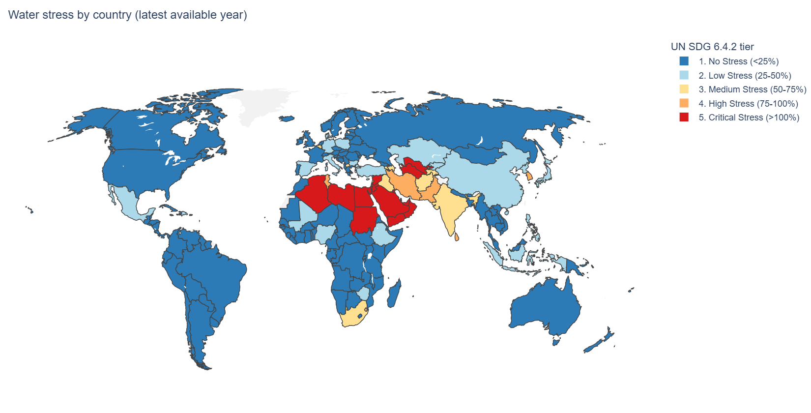
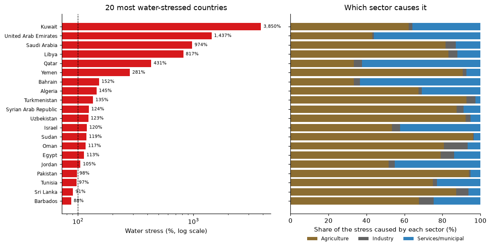
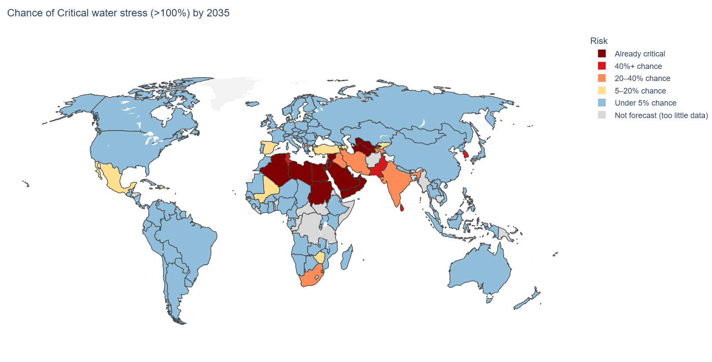
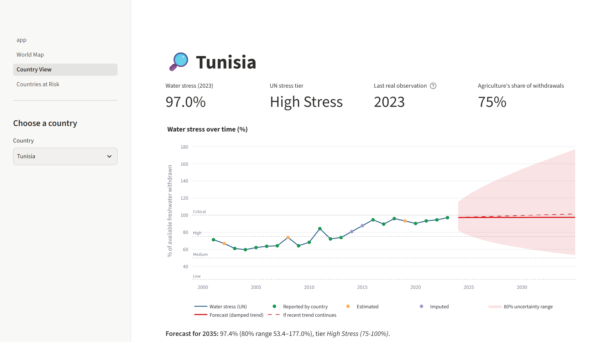

# Water Security & Industrial Stress – Project Report

Data Analysis (GKNM_MSTA025), 2026/27/1 · Team 3 · Nov 25, 2026

## 1. Introduction

Our team (Team 3) worked on water security. The task was to compare global renewable freshwater resources with agricultural and industrial water abstraction, and to build a time-series forecast showing which regions are heading toward critical water stress.

As the main measure we used the UN SDG indicator 6.4.2 (level of water stress). It is total freshwater withdrawal divided by renewable freshwater resources minus environmental flow requirements, expressed in %. The UN classifies the values into five levels, from no stress (below 25%) to critical stress (above 100%).

We looked at three questions: where water stress is highest and which sector causes it, how stress and withdrawals changed between 2001 and 2023, and which countries may reach high (75%) or critical (100%) stress by 2035. The code, data and outputs are available in our repository: [github.com/petikovacs/data_analysis](https://github.com/petikovacs/data_analysis).

## 2. Data sources and data processing

We combined four public data sources into one country-year dataset covering 183 countries between 2001 and 2023 (4,181 rows, 32 columns). All data ingestion and transformation is scripted in Python (pandas, NumPy, pycountry); no data file was edited manually (e.g. in Excel).

| Source | Variables used | Unit / note |
| :--- | :--- | :--- |
| UNSD Environmental Indicators – Water | Renewable freshwater resources; freshwater abstracted | million m³ → 10⁹ m³/yr; sparse (≈29% of country-years) |
| FAO AQUASTAT | Total, industrial and municipal withdrawal | 10⁹ m³/yr; reliability flag A/E/I/X |
| Our World in Data | Agricultural withdrawal (republished AQUASTAT) | m³ → 10⁹ m³/yr |
| UN SDG Global Database, 6.4.2 | Level of water stress and its sector parts | %; status A/E/I/O |

The pipeline consists of two scripts. The first one (`01_audit_and_profile.py`) checks every raw file for its shape, missing values, duplicates, units, flags and outliers. The second one (`02_clean_and_merge.py`) cleans the data and builds the master dataset.

The main difficulty was that country names are written differently in each source. We therefore joined all tables on the UN M49 numeric country code and added ISO3 codes for the maps. Regional aggregates (for example the `OWID_*` rows) were removed. All volumes were converted to 10⁹ m³/year, and the footnotes that the UNSD Excel files mix into the country column were moved into a separate footnote table.

From the merged data we calculated the sector shares, the five SDG stress categories and a simple ratio of abstraction to renewable resources. We compared this ratio with the value published by UNSD, and it matched for all 36 countries where both were available. We also added flags for questionable rows: when the sector sum is larger than the total, when renewable resources are negative (Cabo Verde, Gambia, Trinidad and Tobago), when the UNSD and FAO volumes differ by more than ten times, and when a methodological footnote applies.

During cleaning we noticed that the UN repeats the last stress value in years without a new survey. About 32% of all stress values are such repeats. We flagged them and treated them as missing in the forecast, because otherwise they would look like a flat trend.

The cleaned data is saved as a CSV file and as an Excel workbook with a data dictionary. The audit tables are in the `reports/` folder.

## 3. Exploratory analysis

Water stress is very unevenly distributed. The median country uses about 10% of its renewable water, but 16 countries use more than 100%. As Figure 1 shows, almost all of them lie in one region stretching from North Africa through the Arabian Peninsula to Central Asia.

*Figure 1. Water stress tier by country, latest available year. Source: UN SDG Global Database; [`reports/maps/map_01_stress_latest`](maps/map_01_stress_latest.html) (interactive version).*

Agriculture is the largest water user in 107 of the 179 countries with sector data, and it causes most of the stress in 17 of the 20 most stressed countries (Figure 2). The exceptions are Gulf states such as Qatar, Bahrain and the United Arab Emirates, where municipal use is larger.

Over time the picture changed little. Global withdrawals grew by about 6% between 2001 and 2023, and the share of agriculture rose from 67% to 71%. Looking at the same set of countries, 15 were in critical stress both in 2001 and in 2023.

We also found that renewable freshwater changes much more from year to year than abstraction (median variability of 23% compared with 11%). In dry years the pressure therefore rises even if water use stays the same, as happened in Morocco in 2021.

Our own abstraction-to-renewable ratio is available for only 58 countries. After removing 5 implausible values, it ranks the countries very similarly to the official indicator (Spearman ρ ≈ 0.94), so we used it only as a cross-check.

Data quality is a real limitation as well. Only about 30% of the stress values are reported directly by the countries, and for 46 countries the last real observation is from 2010 or earlier.

*Figure 2. The 20 most water-stressed countries (log scale) and the share of their stress caused by agriculture, industry and services. Source: `reports/figures/eda_05_top20_sector_drivers`.*

## 4. Forecasting water stress to 2035

For the forecast we used only real UN observations and removed the repeated values. This left 151 countries with enough data.

We compared four models with a back-test: each model was trained on data up to 2015, 2016 and 2018, and then evaluated on the following years, which it had not seen. The best model was a damped recent trend. It starts from the latest value and adds the slope of the last 8 observations, which is reduced step by step. This model had the lowest MAE and RMSE at all three cut-offs, while a linear trend fitted on the whole period was clearly the worst.

| Model | MAE 2015 | MAE 2016 | MAE 2018 | RMSE 2018 |
| :--- | ---: | ---: | ---: | ---: |
| Damped recent trend | 6.51 | 4.80 | 4.23 | 14.57 |
| Naive (last value) | 6.74 | 5.07 | 4.38 | 16.56 |
| Damped Holt | 7.69 | 5.81 | 5.42 | 17.61 |
| Linear trend | 11.43 | 9.98 | 8.03 | 32.90 |

The errors are in percentage points. The damping factor (φ = 0.5) was chosen on the 2016 cut-off and checked on 2018. We built 80% uncertainty ranges from the back-test errors; on the unseen years they covered 87% of the actual values, so they are slightly too wide rather than too narrow. We also report a scenario without damping ("trend continues"), but only as a stress test, not as our forecast.

The table below lists the countries that are closest to critical stress by 2035:

| Country | Latest stress (%) | Base 2035 (%) | Chance >100% by 2035 | Crosses 100% if trend continues |
| :--- | ---: | ---: | ---: | :---: |
| Tunisia | 97.1 | 97.4 | 48% | 2032 |
| Pakistan | 98.1 | 95.2 | 46% | – |
| Iraq | 67.8 | 70.3 | 23% | 2035 |
| North Macedonia | 65.9 | 69.5 | 22% | 2033 |
| Lebanon | 58.8 | 61.1 | 21% | 2033 |
| Cabo Verde | 59.7 | 63.6 | 18% | 2033 |
| Mali | 43.0 | 47.6 | 8% | 2033 |

*Figure 3. Chance of reaching Critical water stress (>100%) by 2035, from the damped-trend forecast. Source: [`reports/maps/map_05_critical_risk_2035`](maps/map_05_critical_risk_2035.html) (interactive version).*

Sri Lanka, South Korea and Eswatini also have a 37–45% chance, but their last real data point is from 2005, so these results are much less reliable. We also checked whether a higher agricultural share goes together with higher stress. The relationship is significant but weak (Spearman ρ ≈ 0.29, p < 0.001, R² ≈ 0.08), which suggests that the amount of water a country has matters more than how it uses it.

## 5. Visualisation, reproducibility and collaboration

Besides the static figures in `reports/figures/`, we created interactive Plotly maps (`reports/maps/`). They show the stress level in the latest year, an animated map for 2001–2023, the share of agriculture in water use, how recent each country's data is, and the chance of critical stress by 2035.

The Streamlit dashboard (`dashboard/`) is aimed at readers without a technical background. It has an overview page, a world map for any year between 2001 and 2035, a country page and a page for the countries at risk, with CSV downloads. The dashboard does not recalculate anything: it reads the files produced by the pipeline, so its numbers are the same as in this report. It can be started from the repository root with `python -m streamlit run dashboard/app.py`.

| Page | What the reader can do |
| :--- | :--- |
| Overview | Headline numbers, the latest stress map, key findings and how to read the stress tiers |
| World Map | Observed stress for any year 2001–2023 (or animated), forecast stress for any year 2024–2035, or agriculture's share of water use |
| Country View | Stress history with each value marked as reported, estimated, imputed or repeated; the 2035 forecast with its 80% range; the sector mix and a CSV download |
| Countries at Risk | Countries that may cross 75% or 100% by 2035, with their chance, crossing years and a CSV download |

*Figure 4. Country View page of the Streamlit dashboard for Tunisia: real observations (by reporting status) up to 2023 and the damped-trend forecast with its 80% uncertainty range up to 2035.*

To keep the work reproducible, the dependencies are listed in `requirements.txt`, and the README describes the order in which the scripts and notebooks have to be run. The forecasting and map functions are in separate modules (`src/water_forecast.py`, `src/water_maps.py`) with docstrings. In Git we used descriptive commit messages (feat, fix, chore), and the dashboard was developed on its own branch (`feature/dashboard`). The raw files are kept unchanged, and their sources are documented in `data/raw/SOURCES.md`.

## 6. Limitations and conclusions

Our results have some limitations. Water stress is not measured every year: about a third of the values are repeats, and for some countries the last new value is from 2005–2010, so their forecasts are uncertain. The UNSD data on renewable resources and abstraction is sparse, and some countries report only part of their territory (for example only certain cities), which is why we used our own ratio only as a cross-check. Finally, the forecast only continues each country's own history. It does not take climate change, population growth or policy decisions into account, and the uncertainty ranges only reflect past forecast errors.

In summary, 16 countries already use more water than is renewably available, and this group hardly changed between 2001 and 2023. In most of them agriculture is the main cause, and its share of global withdrawals is still growing. By 2035, Tunisia and Pakistan are the most likely to reach critical stress (about a 50% chance). If recent trends continue, Iraq, North Macedonia, Lebanon, Cabo Verde and Mali could follow between 2033 and 2035. In our view, more frequent reporting by the countries would improve these forecasts more than a more complex model would.

## 7. Team and contributions

| Member | Role and contribution |
| :--- | :--- |
| Kovács Péter | Project report: structure, analysis write-up and conclusions |
| Jamoos Eman Naim Asad (Member 3) | Data cleaning & integration: cleaned the datasets, handled missing values, standardised column names and ISO country codes, matched countries across sources and merged them into one dataset (`src/01_audit_and_profile.py`, `src/02_clean_and_merge.py`) |
| Boughalmi Mohamed Ghassen | Data collection and upload: raw data sources and repository structure |
| Khan Afzal Mahmud Nakib (Member 5) | Dashboard & visualisation: interactive Streamlit dashboard (`dashboard/`) with overview, world map, country view and countries-at-risk pages |
| Das Himel | Project presentation (slides) |
